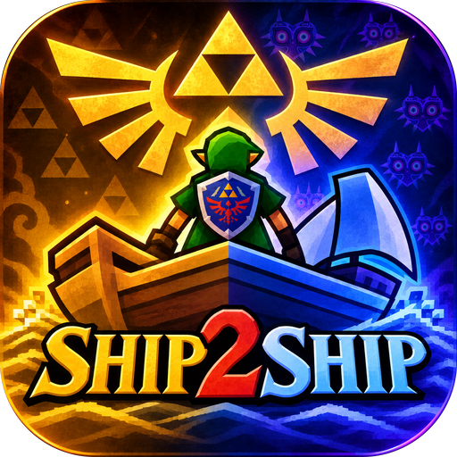

# Ship2Ship

**Ocarina of Time and Majora's Mask in one PC port: a cross-game randomizer in the spirit of
[OoTMM](https://ootmm.com/), each game on its own, and Majora's Mask's forms and masks in Hyrule.**

> [!IMPORTANT]
> **Ship2Ship is an unofficial fan project.** It is not made by, affiliated with or endorsed by HarbourMasters,
> the 2 Ship 2 Harkinian team, Varuuna (ComboShip), Captain-Backwash (WomboComboShip) or the OoTMM team. Please
> report problems here, never to those projects. Parts of it were written with AI assistance. Nearly all of the
> work it runs on belongs to the projects in [`CREDITS.md`](CREDITS.md).

Ship2Ship runs [Ship of Harkinian](https://github.com/HarbourMasters/Shipwright) (Ocarina of Time) and
[2 Ship 2 Harkinian](https://github.com/2ship2harkinian/2ship2harkinian) (Majora's Mask) as one program. In a
cross-game seed, entrances such as the Happy Mask Shop and the Clock Tower lead from one game into the other, and
both games share one save file. It grew
out of [Varuuna's ComboShip](https://github.com/Varuuna/ComboShip) and
[Captain-Backwash's WomboComboShip](https://github.com/Captain-Backwash/WomboComboShip), and keeps both ports'
enhancements, mod support and co-op.

> [!WARNING]
> **Early test build.** Expect bugs. It is not ready for races or leaderboards. Saves and seeds from one test build
> may not carry over to the next.

## What you can play

Each save file picks its own mode on the file-select screen:

| Mode | What it is |
|---|---|
| **Randomizer** | A seed generated from the Randomizer settings. The **Games** setting makes it a cross-game seed (Ocarina of Time + Majora's Mask), or Ocarina of Time only, or Majora's Mask only. |
| **Normal** | Plain Ocarina of Time. |
| **Master Quest** | Plain Ocarina of Time with the Master Quest dungeons. It needs a Master Quest ROM. |
| **Majora's Mask** | Plain Majora's Mask. |

The file-select screen labels each slot with its mode: `COMBO`, `OOTR`, `MMR`, `MQ` or `MM`.

## Features

**Across the two games**
- Majora's Mask in Hyrule: Deku, Goron, Zora and Fierce Deity Link with their moves, plus MM's masks (the Blast
  Mask included) and items.
- Ocarina of Time in Termina: OoT items such as the Boomerang, Slingshot and Megaton Hammer, and adult Link.
- Pause menus that show both inventories.
- Trackers for both games' items and checks.
- **Optional:**
  - shared health, magic and ammo
  - logic that counts the Zora and Goron forms' abilities (a seed setting)
  - transformations in a plain Ocarina of Time save
  - a **Lost Woods link**: a wrong turn in Hyrule's Lost Woods leads into Termina's, and the Clock Tower leads
    back

**From the ports**
- Each port's own enhancements, cheats and cosmetics, in one combined menu.
- Texture, model and music mods for both games.
- Co-op through the Anchor mode, with background world sync, a partner feed and game-switch notices.
- On first launch, import settings from a Ship of Harkinian, 2 Ship 2 Harkinian, ComboShip or Ship2Ship install.
- Presets, so you can switch between saved sets of settings.

**Not yet:** Archipelago, and WomboComboShip's synced co-op enemies.

## Getting started

1. Download the build for your system from [Releases](../../releases): Windows (zip), Linux / Steam Deck
   (AppImage) or macOS (dmg).
2. Have your own legally dumped ROMs ready:
   - an Ocarina of Time ROM that Ship of Harkinian supports
   - a Majora's Mask ROM that 2 Ship 2 Harkinian supports
   - optionally, an Ocarina of Time Master Quest ROM for Master Quest saves

   **No game data is included or shared here.**
3. Start Ship2Ship.
   - The **ROM Setup** screen turns your ROMs into game archives. You only do this once.
   - Then you can import your settings from another install, or skip that step.
4. On the file-select screen, choose a mode for a new file and play. The randomizer settings are in the menu.

**Where your files live**
- **Windows:** next to `Ship2Ship.exe`: `ship2ship.json` (settings), `Save\`, `mods\` and `logs\`.
- **macOS:** `~/Library/Application Support/com.ship2ship.Ship2Ship`.
- **Linux AppImage and Steam Deck:** a `Ship2Ship-data/` folder next to the AppImage, which holds the saves,
  settings, mods and game archives. Run `chmod +x` on the AppImage first. To keep the data somewhere else, set
  `SHIP_HOME`.

## Building it yourself

| | Commands |
|---|---|
| **Windows** (Visual Studio 2022 or newer, CMake 3.26+) | `cmake -S . -B build/x64 -A x64`, then `cmake --build build/x64 --config Release --target Ship2Ship` |
| **Linux** | See [`docs/BUILDING_LINUX.md`](docs/BUILDING_LINUX.md) |

The first configure fetches the dependencies. Contributor docs are in [`docs/`](docs/): `docs/ARCHITECTURE.md`,
`docs/combo/` and `docs/deviations/`.

## Credits

Ship2Ship stands on a lot of other people's work. See [`CREDITS.md`](CREDITS.md).

## License

Nothing is relicensed here. Each bundled project keeps its own license: see the repositories in
[`CREDITS.md`](CREDITS.md) and [`libultraship/LICENSE`](libultraship/LICENSE). Ship2Ship's own changes are offered
under the same terms as the files they modify.
